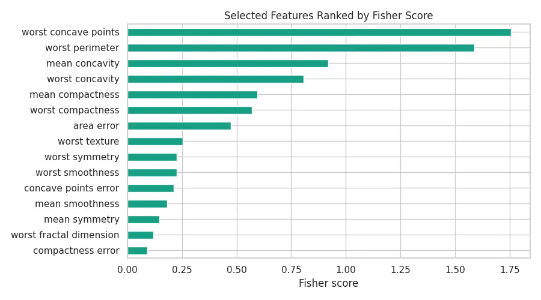
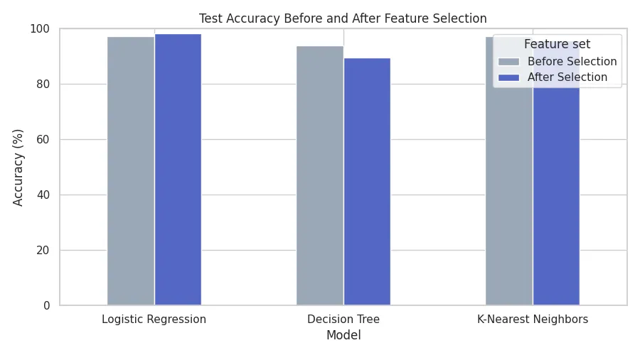
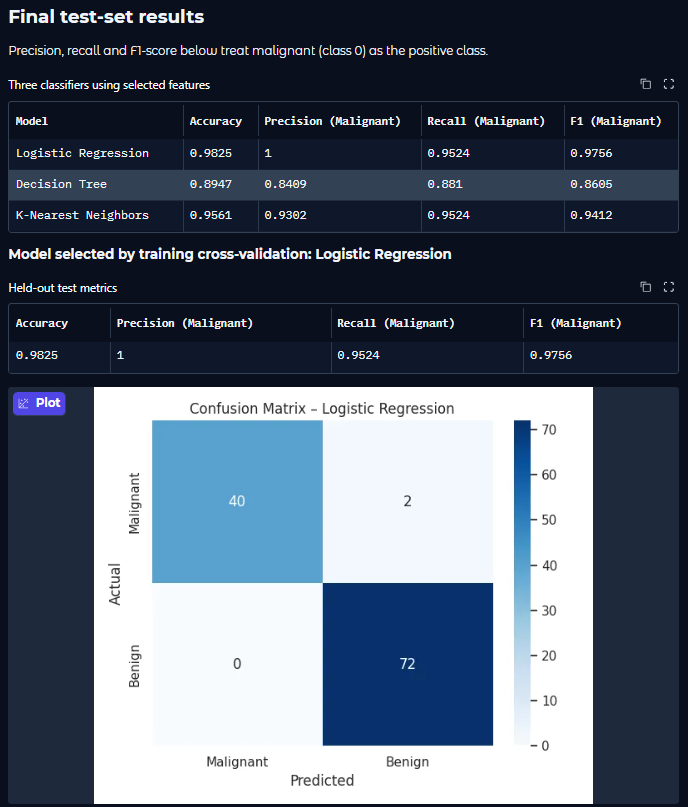

# Statistical Feature Selection for Classification: Breast Cancer Wisconsin

## 📖 Description

This project explores statistical feature selection for classifying the Breast Cancer Wisconsin Diagnostic dataset as **malignant** or **benign**. The notebook analyzes feature variance, covariance, correlation, and class separation, then compares classifiers using all features and a selected subset.

The workflow is built to keep feature selection inside the training pipeline. Cross-validation folds learn their own selected features, and the held-out test set is reserved for final evaluation. A Gradio dashboard in the notebook presents the analysis and supports individual or CSV predictions.

## What Is Statistical Feature Selection

Feature selection chooses a smaller set of input measurements that carry useful information for a prediction task. This notebook removes constant features, ranks the rest by Fisher score, and removes redundant features when their absolute correlation exceeds 0.90.

Variance is used only to identify constant features. Since the measurements have different units and scales, raw variance values are not compared as if they were directly equivalent.

## How It Works

1. Load the diagnostic dataset and review its classes and measurements.
2. Split the data into training and held-out test sets.
3. Analyze variance, covariance, correlation, and Fisher scores.
4. Fit feature selection and scaling within training pipelines.
5. Compare three classifiers with repeated cross-validation and small hyperparameter searches.
6. Evaluate the selected pipelines once on the held-out test set.
7. Explore the results and make sample predictions in the Gradio dashboard.

## 🎯 Objectives

- Examine statistical relationships among the 30 measurements
- Remove constant and highly redundant features
- Compare selected-feature models with all-feature baselines
- Refit feature selection and scaling inside each cross-validation fold
- Save the selected pipeline and project result files from the notebook
- Provide an interactive dashboard for reviewing results and predictions

## 🧠 Technologies Used

- Python
- Scikit-learn
- Pandas and NumPy
- Matplotlib and Seaborn
- SciPy
- Gradio
- Joblib

## 📂 Dataset Information

- Dataset: Breast Cancer Wisconsin Diagnostic, loaded with `sklearn.datasets.load_breast_cancer`
- Samples: 569
- Input features: 30 numeric measurements
- Target classes: malignant (0) and benign (1)
- Held-out test set: 114 samples

The notebook treats malignant cases as the positive class when reporting precision, recall, and F1-score.

## Project Structure

```text
.
|-- README.md
|-- README_assets/
|   |-- final_test_results_confusion_matrix.png
|   |-- selected_features_fisher_score.png
|   `-- test_accuracy_before_after_selection.png
`-- Statistical_Feature_Selection_Breast_Cancer_Final.ipynb
```

When the notebook is run, it also creates `feature_selector.py`, a saved selected-feature pipeline, a selected-feature list, result CSV files, and a `requirements.txt`. Those generated files are not included in the repository until the notebook is run and the files are added.

## Requirements

- Python 3
- pip
- JupyterLab or Google Colab

The first notebook section installs the libraries used by the analysis and dashboard.

## ⚙️ Installation & Setup

```bash
git clone https://github.com/LOKESHBOOTU/Statistical-Feature-Selection-for-Classification.git
cd Statistical-Feature-Selection-for-Classification
python -m venv .venv
```

Activate the environment, then install the notebook dependencies:

```powershell
.venv\Scripts\Activate.ps1
python -m pip install jupyterlab gradio scikit-learn pandas numpy matplotlib seaborn scipy joblib
jupyter lab
```

On macOS or Linux, activate with `source .venv/bin/activate`. Open `Statistical_Feature_Selection_Breast_Cancer_Final.ipynb` and run its cells in order to reproduce the analysis and launch the dashboard.

## 🔍 Methodology / Workflow

1. **Load and inspect data**  
   Load the built-in diagnostic dataset and review the class distribution and feature measurements.

2. **Split the data**  
   Keep a held-out test set for the final evaluation.

3. **Analyze features**  
   Review variance, covariance, correlation, and class separability using Fisher scores.

4. **Select features**  
   Remove zero-variance features, rank the remaining features by Fisher score, and drop a feature if its absolute correlation with a higher-ranked kept feature exceeds 0.90. The pipeline tunes the number of selected features from 10, 15, or 20.

### Selected Features Ranked by Fisher Score

The chart shows the selected features in Fisher-score order.



5. **Train and compare models**  
   Compare all-feature and selected-feature pipelines for each classifier. Repeated stratified cross-validation uses 5 folds and 3 repeats; grid search tunes a small set of classifier settings.

6. **Evaluate and choose a model**  
   Choose the selected-feature model using training cross-validation F1-score for the malignant class. Use the held-out test set only for the final evaluation.

7. **Explore the dashboard**  
   Review the statistical analysis, feature selection, and model comparison, then enter all 30 measurements or upload a CSV with the original feature columns for predictions.

## 🤖 Models Used

### Classification Models

- Logistic Regression
- Decision Tree
- K-Nearest Neighbors (KNN)

The notebook compares each model with all 30 features and with statistical feature selection. Scaling and selection are fitted within the model pipelines during cross-validation.

## 📊 Results / Accuracy

The following are the notebook's recorded results on its 114-sample held-out test set:

| Feature set | Model | Accuracy | Precision (Malignant) | Recall (Malignant) | F1 (Malignant) |
| --- | --- | ---: | ---: | ---: | ---: |
| All 30 features | Logistic Regression | 0.9737 | 0.9756 | 0.9524 | 0.9639 |
| All 30 features | Decision Tree | 0.9386 | 0.9268 | 0.9048 | 0.9157 |
| All 30 features | K-Nearest Neighbors | 0.9737 | 1.0000 | 0.9286 | 0.9630 |
| Statistical selection | Logistic Regression | 0.9825 | 1.0000 | 0.9524 | 0.9756 |
| Statistical selection | Decision Tree | 0.8947 | 0.8409 | 0.8810 | 0.8605 |
| Statistical selection | K-Nearest Neighbors | 0.9561 | 0.9302 | 0.9524 | 0.9412 |

### Test Accuracy Before and After Feature Selection



**Selected model:** Logistic Regression with 15 features  
**Training cross-validation F1 (malignant):** 0.9607  
**False negatives in the recorded test evaluation:** 2

These values describe one run and one held-out split; small differences may be due to the dataset's size. Model selection is based on training cross-validation, not test-set performance.

## 📸 Dashboard / Output

The notebook builds a Gradio dashboard with sections for Overview, Statistical Analysis, Feature Selection, Model Evaluation, Comparison, and Prediction. The prediction section accepts individual measurements or a CSV containing the original 30 feature columns.

The final Model Evaluation output includes the selected model's test metrics and confusion matrix:



The dashboard share link produced by a notebook run is temporary.

## 🚀 Features

- Statistical feature analysis and Fisher-score ranking
- Correlation-based redundancy removal
- All-feature and selected-feature model comparisons
- Repeated cross-validation with feature selection inside each fold
- Logistic Regression, Decision Tree, and KNN pipelines
- Gradio dashboard for results and sample predictions
- Notebook cells that save the trained pipeline and result files

## Applications

- Learning statistical feature selection and classification workflows
- Demonstrating cross-validation pipelines without feature-selection leakage
- Exploring medical measurement data for educational purposes
- Comparing compact feature sets with full-feature baselines

## Why This Project Is Useful

- Shows how statistical analysis can guide feature selection
- Demonstrates an evaluation workflow that keeps the test set separate
- Compares multiple classifiers using consistent training and evaluation steps
- Connects notebook analysis to an interactive prediction dashboard

## ⚠️ Limitations

- The dataset is small, and the held-out test set contains 114 samples.
- Results from one split do not establish performance on other populations or data sources.
- Prediction quality depends on inputs matching the dataset's original 30 measurements and feature order.
- The dashboard is an educational demonstration, not a clinically validated diagnostic system. Do not use it to make medical decisions.
- Gradio share URLs from notebook runs are temporary.

## 🔮 Future Improvements

- Validate the workflow on additional datasets and external test cohorts
- Add saved plots and reports as standalone repository artifacts
- Package the dashboard as a separate application for persistent deployment
- Add feature-level explanations for individual predictions

## 👨‍💻 Author / Contributors

- [LOKESHBOOTU](https://github.com/LOKESHBOOTU)

## 📄 License

No license file is currently included in this repository.

## Deployment

Run the notebook in Jupyter or Google Colab to create the dashboard and saved model artifacts. For a persistent public application, deploy the Gradio app and its generated model files to a hosting service; the notebook's temporary share link is not permanent.
